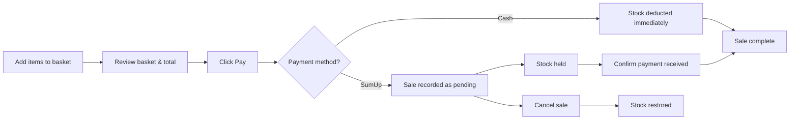
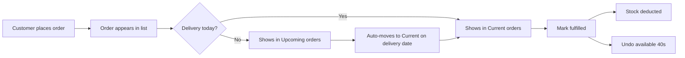
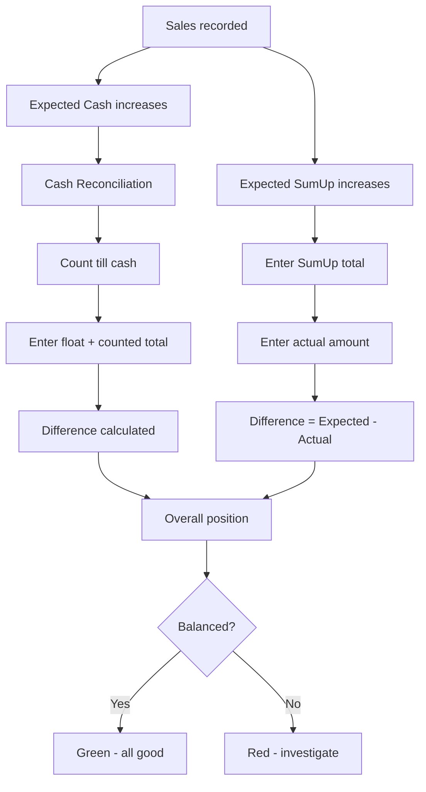

# Porty Tuck Shop — User Guide

A simple, step-by-step guide to using every feature of the Porty Tuck Shop system.

> **Note:** This guide uses Mermaid diagrams. They render automatically on GitHub, GitLab, and most markdown viewers. If diagrams don't appear, use a markdown viewer that supports Mermaid.

---

## Table of Contents

1. [Getting Started](#getting-started)
2. [Logging In](#logging-in)
3. [Stock Management](#stock-management)
4. [Selling Items](#selling-items)
5. [Basket & Checkout](#basket--checkout)
6. [Payment Methods](#payment-methods)
7. [Orders (Delivery)](#orders-delivery)
8. [Events](#events)
9. [Money Tab](#money-tab)
10. [Admin Panel](#admin-panel)
11. [Maintenance Mode](#maintenance-mode)
12. [Barcode Scanning](#barcode-scanning)
13. [Deals](#deals)
14. [Tips & Troubleshooting](#tips--troubleshooting)

---

## App Overview

```mermaid
graph TD
    A[Porty Tuck Shop] --> B[📦 Stock]
    A --> C[🛒 Sell]
    A --> D[📝 Orders]
    A --> E[📅 Events]
    A --> F[💰 Money]
    A --> G[⚙️ Admin]
    A --> H[🔧 Maintenance]

    B --> B1[Add/Edit/Delete items]
    B --> B2[Barcode scanning]
    B --> B3[Low stock alerts]

    C --> C1[Single item sale]
    C --> C2[Basket sale]
    C --> C3[Barcode to basket]

    D --> D1[Place orders]
    D --> D2[Recurring orders]
    D --> D3[Public order link]

    E --> E1[Create events]
    E --> E2[Track sales per event]

    F --> F1[Balances]
    F --> F2[Cash reconciliation]
    F --> F3[SumUp tracking]
    F --> F4[Deals]
    F --> F5[Pending payments]

    G --> G1[User management]
    G --> G2[Security code]
    G --> G3[Backup/Restore]

    H --> H1[Take down now]
    H --> H2[Schedule maintenance]
```

## Getting Started

### What is Porty Tuck Shop?
Porty Tuck Shop is a web-based point-of-sale (POS) system for running a tuck shop. It tracks stock, records sales, manages orders, events, and money (cash + SumUp).

### Accessing the app
- Open your browser and go to your deployed URL (e.g., `https://porty-tuck.shop-app.workers.dev`)
- The app works on desktop, tablet, and mobile
- Data is saved automatically to the cloud (Cloudflare D1 database)

### First-time setup
On first load, the system creates two default accounts:
- **Admin**: username `admin` (temporary password shown on screen)
- **Owner**: username `backdoor` (temporary password shown on screen)

> ⚠️ Save these passwords immediately — they are shown only once!

---

## Logging In

1. Enter your **username** and **password**
2. Click **Log in**
3. You'll be taken to the **Stock** tab

### User roles
| Role | Access |
|------|--------|
| **Admin** | All tabs including Money, Admin, Maintenance |
| **Seller** | Stock, Sell, Orders, Events only |
| **Owner (backdoor)** | Everything + Maintenance mode control |

### Changing your password
- Admins can change any user's password via the **Admin** tab
- Users with "must change password" flag will be prompted on next login

### Password recovery
- When an account is created or its password is changed, an admin can optionally save a recoverable copy sealed with the current security code
- Accounts with a recoverable copy show a **Show password** button in the Admin tab
- If the saved copy was sealed with an old security code, reveal will say it is out of date. Use **Repair recovery**, enter the account's current password and the current security code, then reveal it again
- If you do not know the current password, reset it with **Change password** and enter the security code when prompted to re-enable recovery

---

## Stock Management

The **Stock** tab is where you manage your inventory.

### Adding a new item
1. Fill in the form on the left:
   - **Item name** (required): e.g., "Chocolate bar"
   - **Category**: e.g., "Snacks"
   - **Barcode**: scan or type a barcode
   - **Bought price** (required): cost per unit, e.g., 0.30
   - **Selling price** (required): price to customer, e.g., 0.60
   - **Current stock**: quantity on hand, e.g., 25
   - **Low stock alert**: threshold for warning, e.g., 5
   - **∞ Infinite stock**: check if item never runs out
2. Click **Save item**
3. The item appears in the stock table

### Editing an item
- Click on any row in the stock table to load it into the form
- Make changes and click **Save item**

### Deleting an item
- Load the item into the form
- Click **Delete item** (hidden until an item is loaded)

### Searching stock
- Use the **Search stock** box to filter items by name, category, or barcode

### Scanning barcodes
- Click **Scan** next to the barcode field to scan a barcode with your camera
- Or click **Scan to add stock** to scan and add quantities

### Low stock alerts
- Items below their low stock threshold appear in the **Selling** tab as a warning list
- The stock table shows a "Low" status badge

---

## Selling Items

The **Sell** tab is where you record sales.

### Single item sale
1. Find the item in the grid (or search)
2. Click the item card
3. Enter quantity
4. Click **Record sale**
5. Choose payment method (Cash or SumUp)

### Basket sale (multiple items)
1. Click items to add them to the basket (bottom panel)
2. Adjust quantities with +/− buttons
3. Click **Pay** when ready
4. Choose payment method

### Selling Flow

### Barcode scanning to basket
1. Click **Scan barcode** in the basket header
2. Scan the item barcode
3. Item is added to basket automatically
4. Repeat for multiple items
5. Click **Pay**

### Sorting items
Use the sort buttons: Stock (default), Name, Price ↑, Price ↓

### Undoing a sale
- After a cash sale, an **Undo last sale** banner appears for 40 seconds
- Click **Undo last sale** to reverse it (restores stock)
- Requires security code

---

## Basket & Checkout

### Basket features
- **Add items**: Click item cards in the sell grid
- **Remove items**: Click the × button on basket lines
- **Clear basket**: Click "Clear" button
- **Total**: Shown at the bottom of the basket

### Checkout flow
1. Click **Pay** in the basket
2. Payment dialog shows total amount
3. Choose:
   - **Pay with SumUp** → opens SumUp app on phone
   - **Pay with cash** → records as cash sale immediately
4. For cash: stock is deducted immediately, sale recorded
5. For SumUp: sale recorded as "pending", stock held until confirmed

---

## Payment Methods

### Cash
- Stock deducted immediately
- Lifetime revenue/profit updated
- Undo available for 40 seconds

### SumUp (phone app)
- Opens SumUp app via URL scheme
- Sale recorded as "pending"
- Stock held until you confirm payment received
- Go to **Money → Pending payments** to confirm or cancel
- Check the payment in your SumUp app before confirming

### Confirming a SumUp sale
1. Go to **Money** tab → **Pending payments**
2. Click the confirm button (✓) on the sale
3. Enter security code
4. Stock is deducted, lifetime totals updated

### Cancelling a SumUp sale
1. Click the cancel button (×) on the pending sale
2. Enter security code
3. Sale is removed, stock restored

---

## Orders (Delivery)

### Order Flow

### Placing an order
1. Go to **Orders** tab
2. Enter customer name and room/location
3. Pick items from the item picker
4. Set delivery date (or make it recurring)
5. Click **Place order**

### Recurring orders
- Check "Recurring order" checkbox
- Select weekdays (Mon–Fri)
- Set "Repeat until" date
- Orders auto-generate on those days

### Managing orders
- **Current orders**: Orders due today
- **Fulfill**: Mark as handed over (deducts stock)
- **Remove**: Cancel with a reason
- **Undo fulfil**: Reverse a fulfillment (40-second window)

### Public order link
- Click **Copy order link** to get a URL customers can use to place orders themselves
- Public orders appear in the orders list

### Order history
- Last month's fulfilled/removed orders

---

## Events

### Creating an event
1. Go to **Events** tab (admin only)
2. Fill in: name, start date/time, location, details
3. Select items available during the event (or leave empty for all)
4. Click **Save event**

### Managing events
- **Start/End**: Control event status
- **Remove**: Delete an event
- Events show sales, revenue, and profit totals

### Active event banner
- When an event is active, a banner appears at the top
- Sales recorded during the event are attributed to it

### Past events
- Table showing all completed events with their totals

---

## Money Tab

### Overview
The Money tab tracks expected vs. actual cash and SumUp amounts.

### Money Tracking Flow

### Balances section
- **Expected cash/SumUp**: Calculated from sales
- **Actual cash/SumUp**: Manually entered or reconciled
- **Difference**: Expected − Actual (green = over, red = short)
- **Total difference**: Combined cash + SumUp difference

### Cash reconciliation
1. Count the cash in the till
2. Click **Reconcile**
3. Enter: float amount, counted total, notes
4. System calculates difference and saves actual cash
5. History is recorded

### SumUp tracking
- **Enter SumUp total**: Manually enter the actual SumUp amount
- **Remove from expected**: Reduce expected SumUp (for adjustments)
- **Remove from actual**: Reduce actual SumUp (for corrections)

### Deals
- Create deals: select 2+ items (or 1 item with qty > 1) and set a total price
- When all deal items are in the basket in required quantities, deal price applies
- Shows profit/loss vs. item cost (buyPrice)

### Pending payments
- List of SumUp sales awaiting confirmation
- Confirm (✓) or Cancel (×) each one
- Requires security code

### Sales reports
- Filter by date range
- View revenue, profit, units sold
- Breakdown by item and payment method

---

## Admin Panel

### User management
- **Create account**: Add new admin or seller
- **Change password**: Reset any user's password
- **Suspend/Unsuspend**: Disable/enable accounts
- **Force password change**: Require password change on next login

### Security code
- Used for confirming SumUp sales, undoing sales, etc.
- Backdoor account can change the code
- Changing the code re-seals saved password recovery copies automatically; copies that cannot be opened are removed

### Settings
- Security code configuration
- Cash removal code

---

## Maintenance Mode

### Activating maintenance
- **Backdoor account only**
- Click **Take down now** → clears all sessions, shows maintenance screen to all users
- Or **Schedule maintenance** → set a future time with a reason

### During maintenance
- All non-backdoor users see a maintenance screen
- Backdoor account can still log in
- Scheduled maintenance shows a countdown banner

### Ending maintenance
- Click **End maintenance** to bring the system back online

---

## Barcode Scanning

### Scanning an item barcode
1. Go to **Stock** tab
2. Click **Scan** next to barcode field
3. Allow camera access
4. Point camera at barcode
5. Barcode is entered automatically

### Scanning to add stock
1. Click **Scan to add stock**
2. Scan barcode → item found → enter quantity
3. Stock is added

### Scanning to basket
1. Go to **Sell** tab
2. Click **Scan barcode** in basket
3. Scan item → added to basket

### Barcode-to-basket (quick sale)
- Scan an item → it's added to basket immediately
- Scan multiple items → all in basket
- Click Pay when ready

---

## Deals

### Creating a deal
1. Go to **Money** tab → **Deals** section
2. Click **Add deal**
3. Select items (2+ items, or 1 item with quantity > 1)
4. Set deal total price
5. Set end date (optional)
6. Click **Save**

### How deals work
- When all deal items are in the basket in required quantities, the deal price applies
- The deal price replaces the sum of individual prices
- Profit/loss is calculated vs. item cost (buyPrice)

### Deal pricing
- Deal total must equal entered deal total exactly
- Ratio-based scaling applied to each item's sell price
- Shows profit/loss preview in dialog and list

---

## Tips & Troubleshooting

### Common issues

**"No session token" error**
- You're not logged in. Refresh the page and log in again.

**Stock not updating**
- Make sure you clicked "Save item" after editing
- Check if the item has infinite stock enabled

**SumUp payment not confirming**
- Open **Money → Pending payments** and confirm the sale manually
- Make sure the SumUp transaction in your SumUp app matches the sale amount

**Deals not applying**
- Ensure all deal items are in the basket in the required quantities
- Check the deal hasn't expired (end date)

**Barcode scanner not working**
- Allow camera permissions in your browser
- Use HTTPS (camera requires secure context)
- Try a different browser if issues persist

**Page looks broken on mobile**
- The app is responsive but works best on larger screens
- Use landscape mode on tablets for better experience

### Keyboard shortcuts
- The money input uses a custom keypad for touch devices
- Press Enter to submit money inputs

### Data backup
- Use **Admin** tab → **Export backup** to download a JSON backup
- Use **Import backup** to restore from a file

### Security
- Login passwords are hashed and the hashing method has not changed
- Optional password recovery copies are encrypted with the security code and are not sent to the browser
- Sessions expire after inactivity
- Rate limiting on login attempts
- Security headers (CSP, HSTS, etc.) enabled

---

## Quick Reference Card

| Action | Where | Button |
|--------|-------|--------|
| Add stock item | Stock tab | Save item |
| Record sale | Sell tab | Click item → Record sale |
| Pay basket | Sell tab | Pay → Cash/SumUp |
| Place order | Orders tab | Place order |
| Create event | Events tab | Save event |
| Reconcile cash | Money tab → Cash | Reconcile |
| Enter SumUp total | Money tab → SumUp | Enter SumUp total |
| Confirm SumUp sale | Money tab → Pending | ✓ button |
| Create deal | Money tab → Deals | Add deal |
| Add user | Admin tab | Create account |
| Maintenance | Maintenance tab | Take down now |
| Scan barcode | Stock/Sell tab | Scan button |
| Export backup | Admin tab | Export backup |